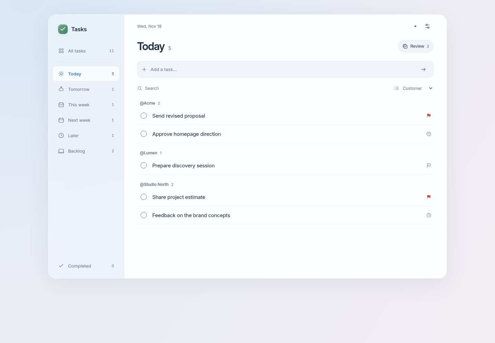
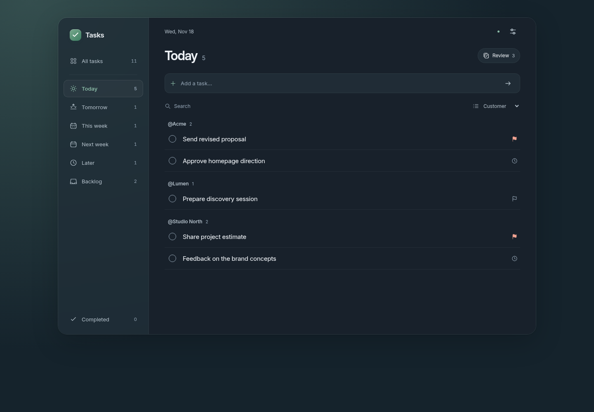
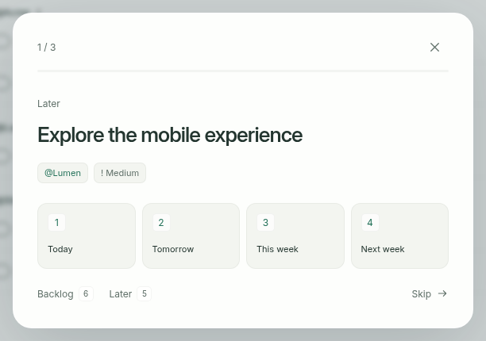
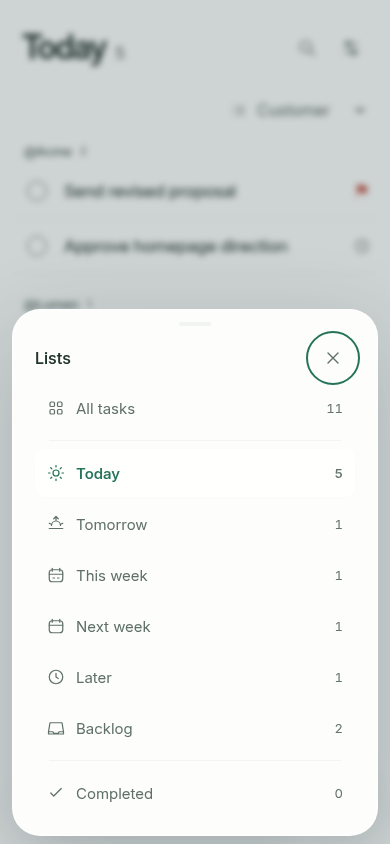

# Glass appearances

Frost is the default. Three selectable appearances share the same task and review workflow; switch them in Appearance. Screenshots use disposable sample data. See [the research and design decisions](design-research.md) for the Apple, Things, Structured, and Todoist references behind this iteration.

## Clear

An opaque task canvas with cool translucent navigation and blue accents.



## Frost

A warm white task canvas, sage accents, and restrained glass navigation. Inter Variable is self-hosted for consistent typography.


## Midnight

A dark task canvas with translucent navigation and muted green accents.



## Review



## Phone




Glass is reserved for navigation and floating controls. Task rows keep priority and waiting indicators inline; these indicators do not create separate metadata lines. Phone navigation, search, and capture use their own layout, with a full list picker and bottom controls.

Surfaces have Safari-prefixed backdrop filters and fallbacks for reduced transparency, reduced motion, and increased contrast. Automated checks include 200% text scaling, touch targets, long titles, and clearance above the phone dock. These screenshots were captured in Chromium. Native Safari and physical Apple-device verification remain outstanding.

To regenerate screenshots using an isolated temporary database and Chromium:

```sh
SCREENSHOT_DIR=docs/screenshots npm run test:browser
```

Set `CHROMIUM` to your installed Chromium/Chrome executable if it is not named `chromium`. The runner never connects to your normal app database.
