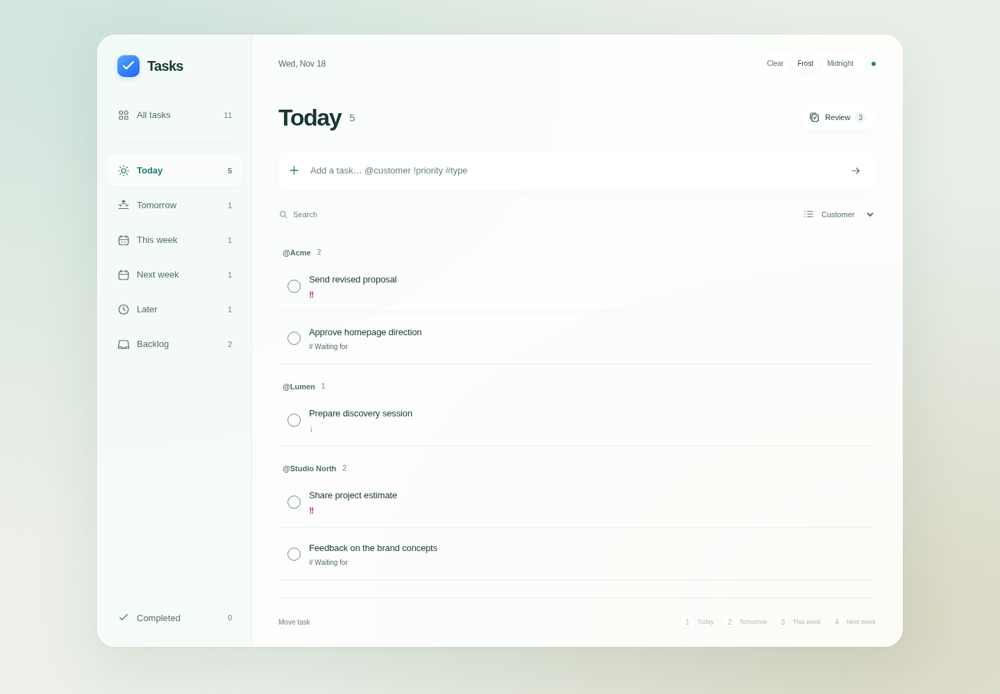
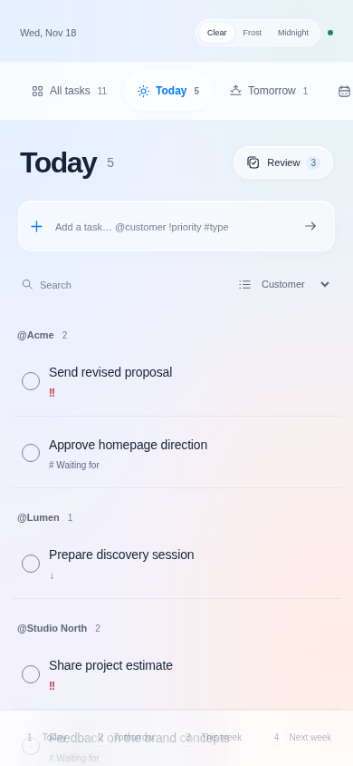
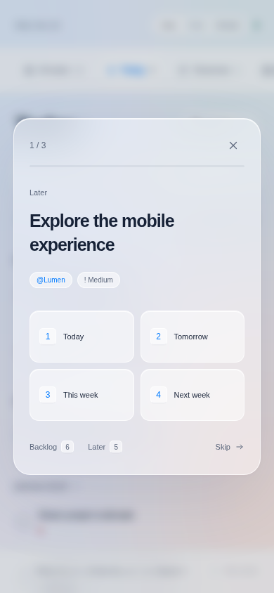

# Glass appearances

Three selectable appearances share the same task and review workflow. Screenshots use disposable sample data.

## Clear

Cool translucent panels, blue accents, and a soft pearl background.


## Frost

Higher-opacity white panels, sage accents, and a quieter background.



## Midnight

Dark translucent panels and cool blue accents.


## Review


## Phone





Surfaces have Safari-prefixed backdrop filters and fallbacks for reduced transparency, reduced motion, and increased contrast. These screenshots were captured in Chromium. Native Safari and physical Apple-device verification remain outstanding.

To regenerate screenshots using an isolated temporary database and Chromium:

```sh
SCREENSHOT_DIR=docs/screenshots npm run test:browser
```

Set `CHROMIUM` to your installed Chromium/Chrome executable if it is not named `chromium`. The runner never connects to your normal app database.
